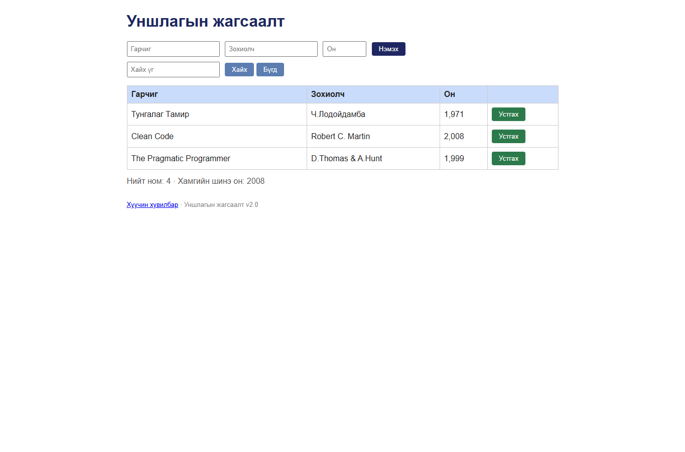

# BUG-01: Хүснэгтийн он мянгатын таслалтай харагдана

Орчин: Уншлагын жагсаалт v2.0, Chromium 159.0.8154.6, Windows 11, 2026-11-18.

Урьдчилсан нөхцөл: өмнөх node app.js процессыг Ctrl+C-ээр зогсоож, Lab7 хавтсанд node app.js гэж шинээр асаасан; анхны 3 номтой, хайлт хоосон.

## Дахин гаргах алхам

1. http://localhost:3000 хуудсыг нээнэ.
2. Анхны гурван номын Он баганыг харна.

Хүлээгдэж байсан: Он энгийн бүхэл тоогоор 1971, 2008, 1999 гэж харагдана.

Бодит үр дүн: Он 1,971, 2,008, 1,999 гэж таслалтай харагдав.

Ноцтой байдал: **Cosmetic** — Өгөгдөл хэвээр боловч оны харагдах хэлбэр спецификацитай зөрж байна.

Олдсон аялал: **Supermodel**.

## Хавсралт

Шинээр асаасан төлөвөөс [дахин шалгасан бүртгэл](../evidence/reproduction-check.json)-ийн 01 мөр confirmed=true байна.
