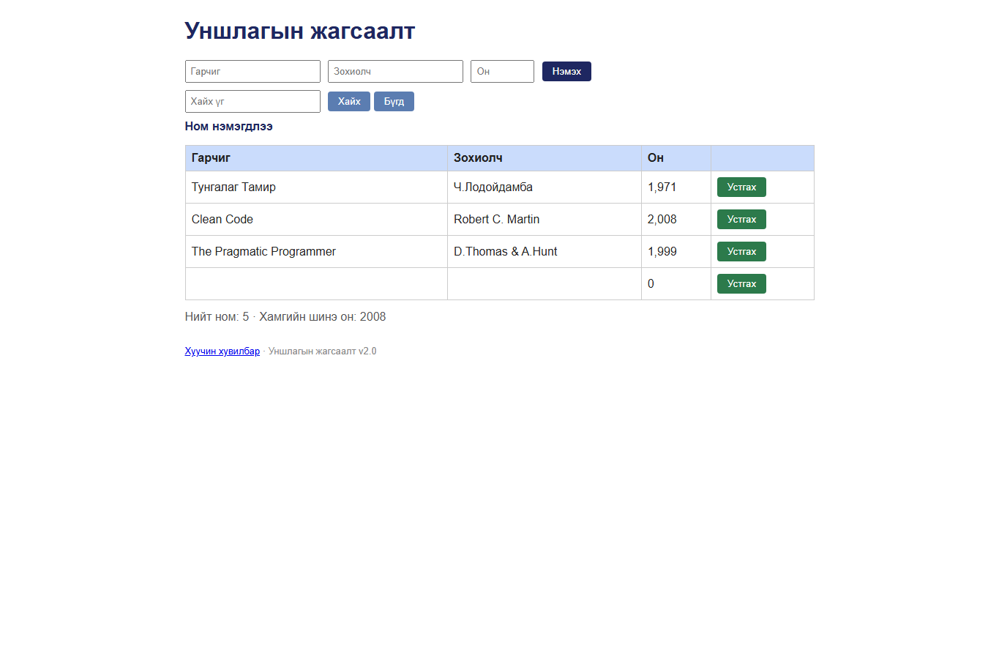

# BUG-02: Заавал бөглөх талбарууд хоосон байхад ном нэмэгдэнэ

Орчин: Уншлагын жагсаалт v2.0, Chromium 159.0.8154.6, Windows 11, 2026-11-18.

Урьдчилсан нөхцөл: өмнөх node app.js процессыг Ctrl+C-ээр зогсоож, Lab7 хавтсанд node app.js гэж шинээр асаасан; анхны 3 номтой, хайлт хоосон.

## Дахин гаргах алхам

1. http://localhost:3000 хуудсыг нээнэ.
2. Гарчиг, Зохиолч, Он талбаруудыг хоосон хэвээр үлдээнэ.
3. Нэмэx товчийг нэг удаа дараад шинэ мөрийг харна.

Хүлээгдэж байсан: Ном нэмэгдэхгүй, заавал бөглөх талбарын ойлгомжтой алдааны мессеж гарна.

Бодит үр дүн: Хоосон гарчиг, зохиолчтой, Он нь 0 гэж харагдах дөрөв дэх мөр нэмэгдэж, «Ном нэмэгдлээ» мессеж гарав. Ганц талбар хоосон эсвэл зөвхөн зайтай хувилбаруудыг мөн энэ согогт нэгтгэв.

Ноцтой байдал: **Major** — Шаардлагатай мэдээлэлгүй ном өгөгдөлд хадгалагдаж байна.

Олдсон аялал: **Couch Potato**.

## Хавсралт

Шинээр асаасан төлөвөөс [дахин шалгасан бүртгэл](../evidence/reproduction-check.json)-ийн 02 мөр confirmed=true байна.
