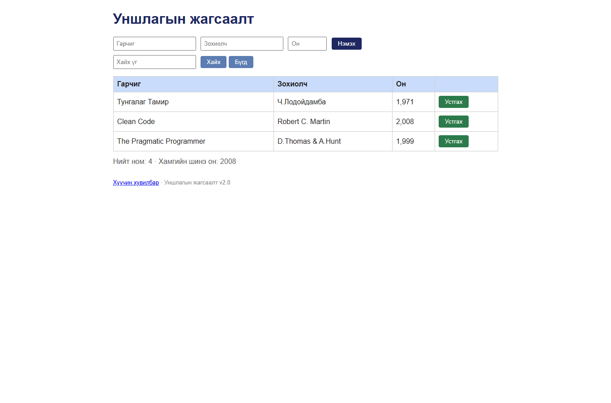

# BUG-04: Нийт ном тоолуур хүснэгтийн мөрөөс нэгээр их байна

Орчин: Уншлагын жагсаалт v2.0, Chromium 159.0.8154.6, Windows 11, 2026-11-18.

Урьдчилсан нөхцөл: өмнөх node app.js процессыг Ctrl+C-ээр зогсоож, Lab7 хавтсанд node app.js гэж шинээр асаасан; анхны 3 номтой, хайлт хоосон.

## Дахин гаргах алхам

1. http://localhost:3000 хуудсыг нээнэ.
2. Хүснэгт дэх номын мөрүүдийг тоолно.
3. Хүснэгтийн доорх Нийт ном утгатай харьцуулна.

Хүлээгдэж байсан: Анхны гурван номын үед «Нийт ном: 3» байна; тоолуур хүснэгтийн номын тоотой тэнцэнэ.

Бодит үр дүн: Хүснэгтэд 3 ном байхад «Нийт ном: 4» гэж харагдав. GET /api/books ч 3 ном буцаасан.

Ноцтой байдал: **Minor** — Хэрэглэгчид өгөгдлийн тоог буруу мэдээлж байна.

Олдсон аялал: **Supermodel**.

## Хавсралт

Шинээр асаасан төлөвөөс [дахин шалгасан бүртгэл](../evidence/reproduction-check.json)-ийн 04 мөр confirmed=true байна.
