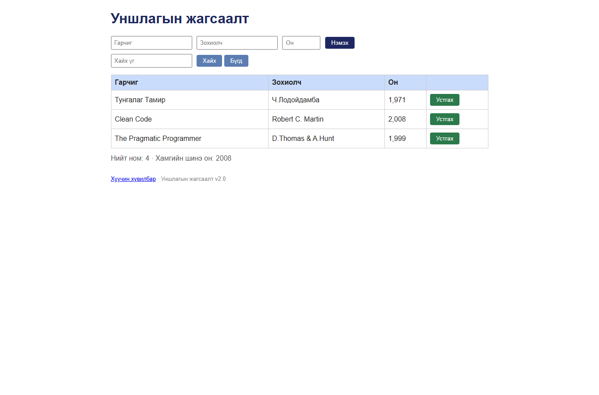

# BUG-05: Устгах товч улаан өнгийн оронд ногоон байна

Орчин: Уншлагын жагсаалт v2.0, Chromium 159.0.8154.6, Windows 11, 2026-11-18.

Урьдчилсан нөхцөл: өмнөх node app.js процессыг Ctrl+C-ээр зогсоож, Lab7 хавтсанд node app.js гэж шинээр асаасан; анхны 3 номтой, хайлт хоосон.

## Дахин гаргах алхам

1. http://localhost:3000 хуудсыг нээнэ.
2. Мөр бүрийн Устгах товчны дэвсгэр өнгийг харна.

Хүлээгдэж байсан: Спецификацийн дагуу аюултай үйлдлийн Устгах товч улаан өнгөтэй байна.

Бодит үр дүн: Устгах товчнууд ногоон; браузерийн тооцоолсон дэвсгэр өнгө rgb(44, 122, 75) байв.

Ноцтой байдал: **Cosmetic** — Устгах үйлдлийн анхааруулах өнгө шаардлагатай таарахгүй байна.

Олдсон аялал: **Supermodel**.

## Хавсралт

Шинээр асаасан төлөвөөс [дахин шалгасан бүртгэл](../evidence/reproduction-check.json)-ийн 05 мөр confirmed=true байна.
