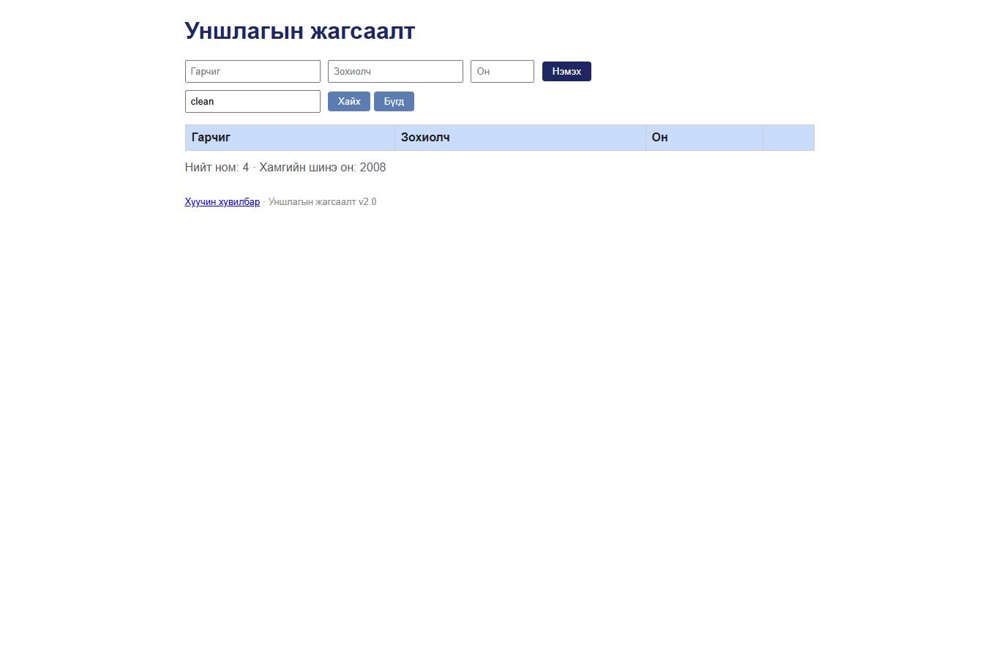

# BUG-06: Хайлт том жижиг үсэг ялгаж байна

Орчин: Уншлагын жагсаалт v2.0, Chromium 159.0.8154.6, Windows 11, 2026-11-18.

Урьдчилсан нөхцөл: өмнөх node app.js процессыг Ctrl+C-ээр зогсоож, Lab7 хавтсанд node app.js гэж шинээр асаасан; анхны 3 номтой, хайлт хоосон.

## Дахин гаргах алхам

1. http://localhost:3000 хуудсыг нээнэ.
2. Хайлтын талбарт Clean оруулаад Хайх товчийг дарна. Clean Code мөр гарсныг харна.
3. Хайлтын утгыг clean болгож солиод Хайх товчийг дахин дарна.

Хүлээгдэж байсан: Хайлт том жижиг үсэг ялгахгүй тул хоёр хайлтад хоёуланд нь Clean Code ном олдоно.

Бодит үр дүн: Clean хайлтад нэг мөр гарсан, clean хайлтад хүснэгт хоосон болов. Тунгалаг / тунгалаг хос дээр мөн ялгаатай үр дүн ажиглагдсан.

Ноцтой байдал: **Major** — Байгаа номыг үсгийн хэмжээнээс болж олохгүй байна.

Олдсон аялал: **Couch Potato**.

## Хавсралт

Шинээр асаасан төлөвөөс [дахин шалгасан бүртгэл](../evidence/reproduction-check.json)-ийн 06 мөр confirmed=true байна.
