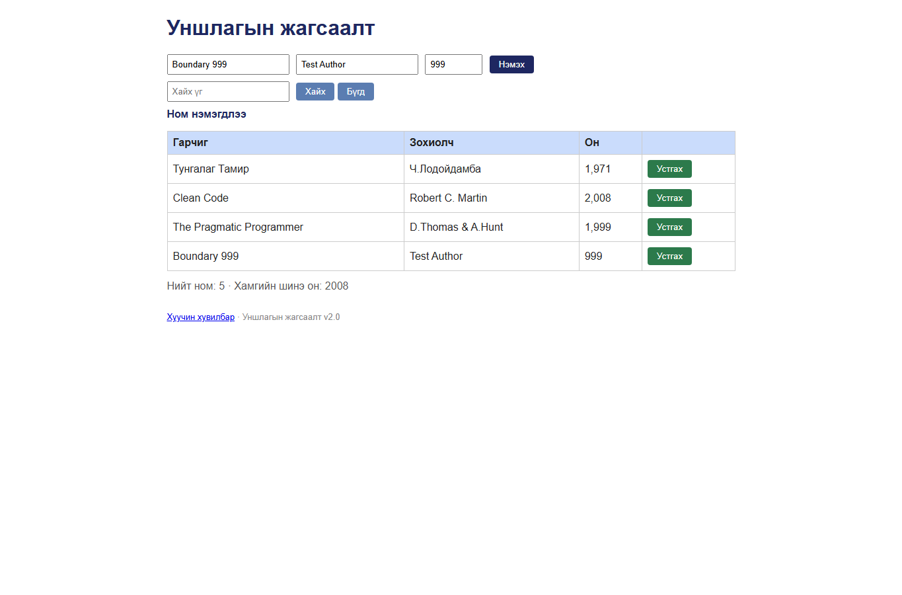

# BUG-07: Он талбар хүрээнээс гадуурх болон бүхэл бус утга зөвшөөрнө

Орчин: Уншлагын жагсаалт v2.0, Chromium 159.0.8154.6, Windows 11, 2026-11-18.

Урьдчилсан нөхцөл: өмнөх node app.js процессыг Ctrl+C-ээр зогсоож, Lab7 хавтсанд node app.js гэж шинээр асаасан; анхны 3 номтой, хайлт хоосон.

## Дахин гаргах алхам

1. http://localhost:3000 хуудсыг нээнэ.
2. Гарчигт Boundary 999, зохиолчид Test Author, онд 999 оруулна.
3. Нэмэx товчийг дараад нэмэгдсэн мөрийг харна.
4. 2101, 1999.5, abc утга бүрийг тусад нь шалгахдаа аппыг дахин шинээр асааж, өөр утгыг Он талбарт оруулна.

Хүлээгдэж байсан: Он 1000–2100 хоорондох бүхэл тоо байна. 999, 2101, 1999.5, abc утга бүхий номыг нэмэхгүй, алдаа мэдээлнэ.

Бодит үр дүн: 999 онтой дөрөв дэх ном нэмэгдэв. Тус бүр шинээр асаасан туршилтад 2101, 1999.5, abc утгууд ч хадгалагдсан; abc нь хүснэгтэд NaN гэж харагдав. Хилийн зөв утгууд 1000, 2100 мөн нэмэгдсэн.

Ноцтой байдал: **Major** — Хязгаар болон төрөл шалгах дүрэм хэрэгжихгүй, буруу он өгөгдөлд хадгалагдаж байна.

Олдсон аялал: **Couch Potato**.

## Хавсралт

Шинээр асаасан төлөвөөс [дахин шалгасан бүртгэл](../evidence/reproduction-check.json)-ийн 07 мөр confirmed=true байна.
