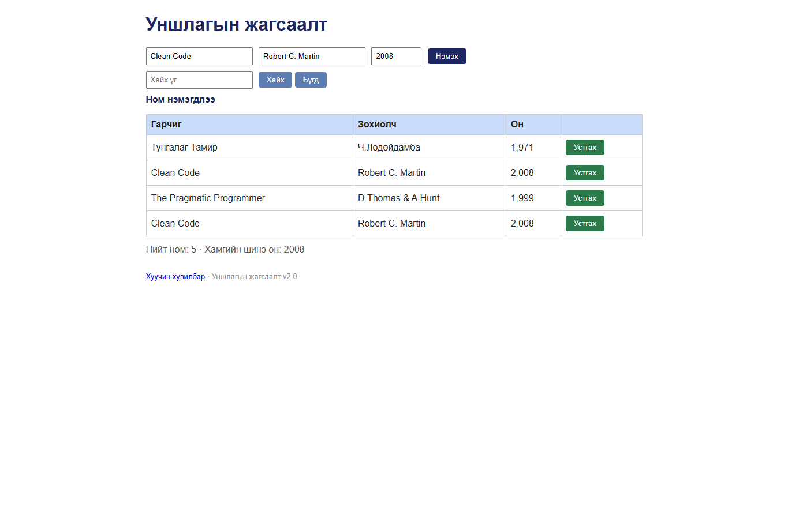

# BUG-08: Ижил гарчиг зохиолчтой ном давхар нэмэгдэнэ

Орчин: Уншлагын жагсаалт v2.0, Chromium 159.0.8154.6, Windows 11, 2026-11-18.

Урьдчилсан нөхцөл: өмнөх node app.js процессыг Ctrl+C-ээр зогсоож, Lab7 хавтсанд node app.js гэж шинээр асаасан; анхны 3 номтой, хайлт хоосон.

## Дахин гаргах алхам

1. http://localhost:3000 хуудсыг нээнэ.
2. Гарчигт Clean Code, зохиолчид Robert C. Martin, онд 2008 оруулна.
3. Нэмэx товчийг нэг удаа дарна.
4. Хүснэгтэд Clean Code ном хэдэн удаа байгааг тоолно.

Хүлээгдэж байсан: Ижил гарчиг, зохиолчтой ном дахин нэмэгдэхгүй; Clean Code ганц мөр хэвээр байна.

Бодит үр дүн: Clean Code / Robert C. Martin / 2008 гэсэн хоёр ижил мөртэй, нийт дөрвөн номтой болов.

Ноцтой байдал: **Major** — Давхардлаас хамгаалах дүрэм зөрчигдөж байна.

Олдсон аялал: **Couch Potato**.

## Хавсралт

Шинээр асаасан төлөвөөс [дахин шалгасан бүртгэл](../evidence/reproduction-check.json)-ийн 08 мөр confirmed=true байна.
