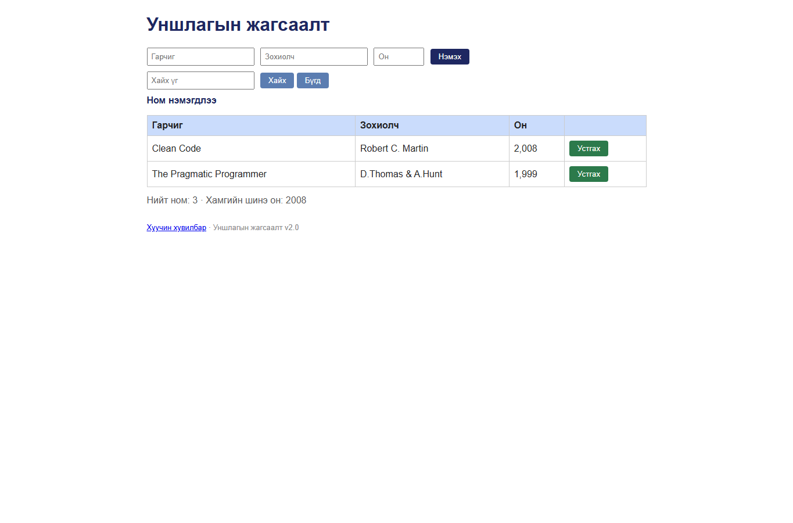

# BUG-09: Ном устгасны дараа Ном нэмэгдлээ мессеж гарна

Орчин: Уншлагын жагсаалт v2.0, Chromium 159.0.8154.6, Windows 11, 2026-11-18.

Урьдчилсан нөхцөл: өмнөх node app.js процессыг Ctrl+C-ээр зогсоож, Lab7 хавтсанд node app.js гэж шинээр асаасан; анхны 3 номтой, хайлт хоосон.

## Дахин гаргах алхам

1. http://localhost:3000 хуудсыг нээнэ.
2. Тунгалаг Тамир мөрийн Устгах товчийг дарна.
3. Үлдсэн мөрүүд болон гарсан мессежийг харна.

Хүлээгдэж байсан: Сонгосон ном устаж, устгасан үйлдэлд тохирсон мессеж гарна.

Бодит үр дүн: Тунгалаг Тамир устаж хоёр мөр үлдсэн боловч «Ном нэмэгдлээ» гэсэн мессеж гарав.

Ноцтой байдал: **Minor** — Үйлдэл зөв хийгдсэн ч хэрэглэгчид эсрэг үйлдлийн баталгаажуулалт өгч байна.

Олдсон аялал: **Supermodel**.

## Хавсралт

Шинээр асаасан төлөвөөс [дахин шалгасан бүртгэл](../evidence/reproduction-check.json)-ийн 09 мөр confirmed=true байна.
