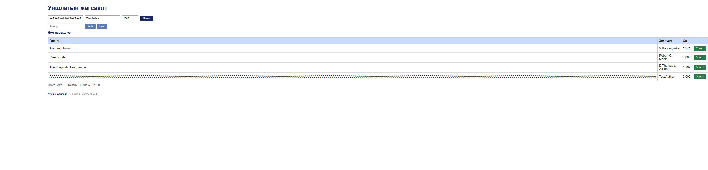

# BUG-10: Урт зайгүй гарчиг хүснэгтийг дэлгэцийн өргөнөөс хэтрүүлнэ

Орчин: Уншлагын жагсаалт v2.0, Chromium 159.0.8154.6, Windows 11, 2026-11-18.

Урьдчилсан нөхцөл: өмнөх node app.js процессыг Ctrl+C-ээр зогсоож, Lab7 хавтсанд node app.js гэж шинээр асаасан; анхны 3 номтой, хайлт хоосон.

## Дахин гаргах алхам

1. Chromium-ийн хуудасны viewport-ийг 1365 × 900 болгож http://localhost:3000 хуудсыг нээнэ.
2. Гарчигт зайгүй 300 ширхэг A, зохиолчид Test Author, онд 2000 оруулна. Доорх PowerShell командаар гарчгийг clipboard-д хуулж болно.
3. Нэмэx товчийг дарна.
4. Хүснэгтийн өргөн болон хуудасны хэвтээ гүйлгэлтийг харна.

```powershell
Set-Clipboard -Value ("A" * 300)
```

Хүлээгдэж байсан: Ямар ч урттай оролтод хүснэгтийн зохиомж эвдрэхгүй; урт гарчгийг мөрлөх эсвэл нүдэнд нь хязгаарлана.

Бодит үр дүн: Viewport 1365px байхад хүснэгт ойролцоогоор 3485.69px, хуудасны нийт өргөн 3738px болж хэвтээ чиглэлд хэтрэв.

Ноцтой байдал: **Minor** — Нэг урт гарчиг бусад багана, үйлдлийг харахад хүндрэл үүсгэж байна.

Олдсон аялал: **Supermodel**.

## Хавсралт



Шинээр асаасан төлөвөөс [дахин шалгасан бүртгэл](../evidence/reproduction-check.json)-ийн 10 мөр confirmed=true байна.
